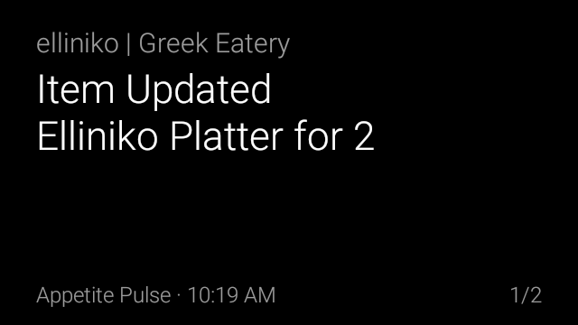
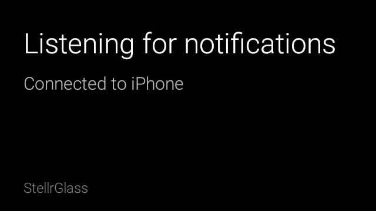
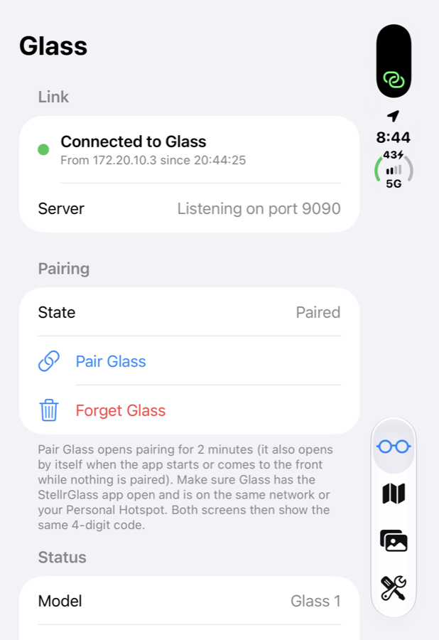

# StellrGlass XE1

> **This project isn't actively maintained.** It's published as-is in case it helps other Glass
> Explorer owners. Issues and pull requests may not get a response. If you want to change
> something, fork it and make it your own. It's MIT licensed.

StellrGlass XE1 brings Google Glass Explorer Edition back to life on its final firmware, XE24,
with an iPhone in place of Google's dead MyGlass servers. The iPhone app is the server; the
Glass app dials it over Wi-Fi (usually the iPhone's Personal Hotspot) and keeps one TCP link
open for everything. It needs an iPhone: there's no Android phone app.

| Feature | How |
|---|---|
| iPhone notifications | Texts and every other iPhone notification, read by Glass straight from iOS over Bluetooth LE (Apple's ANCS). Glass chimes, wakes and shows a card. |
| Timeline card | A live card next to the clock on Glass's home screen shows whether StellrGlass is connected and listening |
| Cards from the iPhone | Cards from the iPhone app, and a Shortcuts "Send to Glass" action for automations |
| Directions | Apple Maps routing on the iPhone; turn cards with arrows and spoken turns on Glass |
| Phone GPS on Glass | iPhone location injected as Android's mock GPS (one adb command to enable) |
| Photo and video backup | New Glass shots upload to the iPhone and land in Photos |
| Screencast | Live view of the StellrGlass screen on the iPhone |
| Wi-Fi setup | A `WIFI:` QR code, a push to a linked Glass, or `wifi.json` over adb |
| Device info and Find my Glass | Battery, storage, Wi-Fi and firmware; last-connected time and place |
| Pairing | A one-time pairing code so only your Glass can connect |

Calls work without any of this: pair Glass as a Bluetooth headset in iPhone Settings.

| An iPhone notification on Glass | The timeline card on Glass |
|---|---|
|  |  |



## Status

Built in October 2026 and partly tested on hardware. With Glass on XE24 and an iPhone on
iOS 27.2 (November 2026):

- **Works:** the iPhone app builds in Xcode 27.2 with no errors or warnings. Glass pairs and
  connects with the iPhone over Personal Hotspot, and new Glass photos land in the iPhone's
  camera roll. iPhone notifications, including texts, show on Glass over Bluetooth. The
  timeline card works, and so do touchpad taps and swipes.
- **Not tried yet:** videos, directions, mock GPS, screencast and background keep-alive.

Known problems:

- **Glass often has to pair over Bluetooth again when it reconnects to the iPhone** (after a
  restart, or after going out of range). Glass shows a 6-digit code and speaks it; type it on
  the iPhone. The iPhone's private Bluetooth address rotates and Glass's KitKat stack can't
  resolve it, and even at the same address the iPhone sometimes refuses the stored key. The
  cause of that isn't known yet (`PROTOCOL.md` §10).
- In the first test the iPhone dropped the Wi-Fi link twice and lost its pairing each time, so
  Glass re-paired with a new code. The cause wasn't found.
- Glass can't delete `wifi.json` after reading it, so the Wi-Fi password stays on the sdcard
  until you remove it with adb.

`TESTING.md` is the hardware runbook, and `CLAUDE.md` keeps the list of what has and hasn't
been verified.

## Layout

| Path | Contents |
|---|---|
| `PROTOCOL.md` | Wire protocol v2: JSON Lines over TCP 9090, raw binary payloads, pairing. The contract between the apps. |
| `glass/` | Glass app: plain Android for API 19 (KitKat), Kotlin, no dependencies |
| `ios/` | iPhone app: SwiftUI for iOS 17+, XcodeGen project |
| `tools/` | Python stand-ins for each side, protocol reference, cross-language checks, adb helper |
| `dist/StellrGlass-debug.apk` | Prebuilt Glass APK |
| `TESTING.md` | Hardware test runbook |
| `CLAUDE.md` | Project rules, owner decisions, verification ledger |

The project was first called GlassBridge, and the code still uses that name internally: the
Android package `au.interstellr.glassbridge`, the iPhone bundle ID, the Bonjour service
`_glassbridge._tcp`, logcat tags and the Xcode project. Both apps show as StellrGlass. If you
publish your own fork, change the package and bundle IDs to your own.

## Glass app

Install the prebuilt APK on a Glass with debug mode on (Settings › Device info › Turn on debug):

```
python3 tools/glass_adb.py install      # adb install -r dist/StellrGlass-debug.apk
python3 tools/glass_adb.py mock         # adb shell settings put secure mock_location 1
python3 tools/glass_adb.py launch       # open the card screen (starts the service)
```

`python3 tools/glass_adb.py --help` lists the rest: `config` (point Glass at a laptop),
`wifi` (push a network), `screen` (screenshot), `logs`, `status`, `invert-swipe`.

To build it yourself you need JDK 17 or later and the Android SDK (platform 35, build-tools
35.0.0); Android Studio provides both. Put `sdk.dir=…` in `glass/local.properties` or set
`ANDROID_HOME`, then:

```
cd glass && ./gradlew assembleDebug     # app/build/outputs/apk/debug/app-debug.apk
```

Debug builds are signed with the committed `glass/debug.keystore`, so APKs from any machine
install over each other. The key is public, so anyone can sign an APK that installs over yours.
Only install builds you trust.

## iPhone app

```
brew install xcodegen
cd ios && xcodegen && open GlassBridge.xcodeproj
```

Set your Team under Signing & Capabilities and run on an iPhone. A free Apple ID works, but
the install expires after 7 days.

Set up: Personal Hotspot with **Maximize Compatibility** on (Glass is 2.4 GHz only), allow
Local Network, then Glass tab › Pair Glass and check both screens show the same code. The
Tools tab has a setup guide.

iPhone notifications on Glass:

1. Allow Bluetooth for StellrGlass, and keep the app open on the iPhone while Glass connects.
   The iPhone is only visible to Glass over Bluetooth while the app is in front.
2. Glass shows a 6-digit code (and speaks it). Type it into the pairing request on the iPhone.
3. In Settings › Bluetooth, tap ⓘ next to Glass and turn on **Share System Notifications**.
   Until you do, Glass connects but receives nothing.

Glass shows notifications that arrive while it's connected, not the backlog already in
Notification Center.

## Automated checks

No hardware needed. From the repo root:

```
python3 tools/test_e2e.py                               # stand-ins, framing, pairing, end to end
(cd glass && ./gradlew testDebugUnitTest)               # FramingTest and core tests (LiveLinkTest skips)
python3 tools/fake_phone.py --selftest --port 9191 &
(cd glass && GLASSBRIDGE_TEST_PORT=9191 ./gradlew testDebugUnitTest)   # LiveLinkTest runs too
kill %1
(cd glass && ./gradlew lintDebug)                       # expect no NewApi issues
tools/swift-check/run.sh                                # iPhone Core vs Python (Swift 6.x)
ios/LinuxCheck/run.sh                                   # Linux only: app type-check against framework stand-ins
```

## Stand-ins

Each app can be tested without the other:

- `python3 tools/fake_phone.py` pretends to be the iPhone: listens on 9090 with a console
  (`card`, `notify`, `nav`, `speak`, `loc`, `cast on`, `wifi`, `pair`, `help` and more), and
  saves photos and screencast frames to `./received/`. Point Glass at it with
  `python3 tools/glass_adb.py config <mac-ip>`.
- `python3 tools/fake_glass.py <iphone-ip>` pretends to be Glass: dials the iPhone app,
  prints everything, and can `--upload` a photo or send a `--frame`.

## Unfinished

- **Re-pairing on reconnect** (see Known problems). A Bluetooth HCI capture of one reconnect
  would show whether Glass offers the stored key and why the iPhone refuses it.
- **Notification actions.** ANCS can also trigger a notification's positive or negative
  action on the iPhone (for example, clear it or decline a call). Glass only reads.
- **Media controls** through Apple's AMS were planned next and haven't been started.

## License

MIT. See `LICENSE`.

StellrGlass XE1 is an independent project and isn't affiliated with or endorsed by Google or Apple.
Google Glass is a trademark of Google LLC. iPhone is a trademark of Apple Inc.
